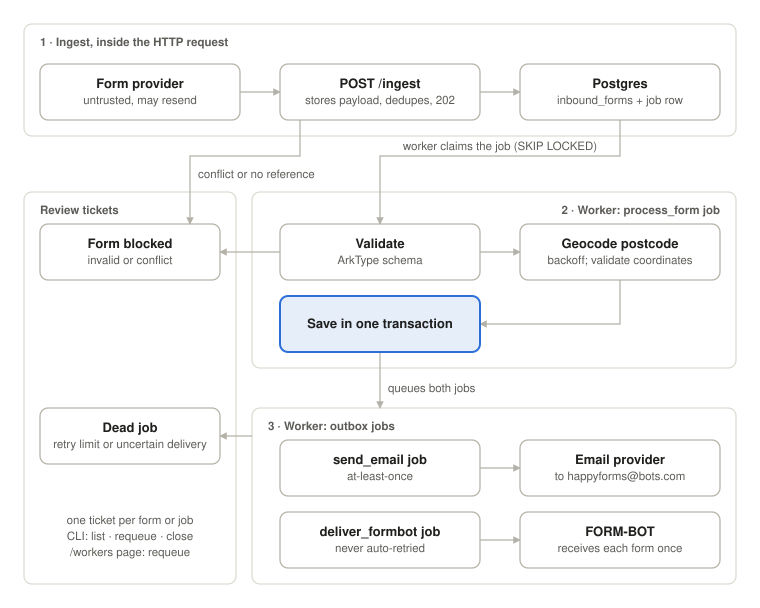

## Architecture



`/ingest` stores payloads and queues durable `process_form` jobs. Workers validate and geocode forms, then save results and enqueue email and FORM-BOT jobs in one transaction. Processing and email jobs retry; uncertain FORM-BOT deliveries need manual review. The CLI can list, requeue, or close review tickets; `/workers` can requeue them.

## Retry configuration

`PROCESS_FORM_MAX_ATTEMPTS` and `SEND_EMAIL_MAX_ATTEMPTS` default to 5 and must be positive safe integers. They limit all failures, including invalid or missing geocoder coordinates and unexpected errors.

Processing and email reuse the existing exponential backoff with equal jitter capped at 5 minutes. After the configured number of failed attempts, the job becomes dead and opens a review ticket. Increase the limits to allow more time for provider outages. FORM-BOT always gets one attempt, then a failure opens a review ticket.

## Running locally

Prerequisites:

* Node.js >=22.9
* Postgres 18
* Docker with Compose (runs Postgres 18)

Install dependencies:

```bash
npm ci
```

Set up the database before starting the app. This creates `.env` if missing, starts Postgres 18 (Docker) and applies migrations:

```bash
npm run db:setup
```

Run the app (reads `DATABASE_URL` from `.env`):

```bash
npm run dev                  # watch mode
npm run build && npm start   # compiled
```

## Recovering a FORM-BOT delivery

`npm run cli -- requeue <id> --confirm-not-delivered --note "<what you checked>"`

Checks: npm run typecheck and npm run lint (both run in CI).

Tests: see [tests/README.md](tests/README.md) for how to run them and what scenarios are covered.

Connect:

```bash
docker compose exec db psql -U postgres -d take_home
```

Stop it with `docker compose down`. Add `-v` to delete the data.
